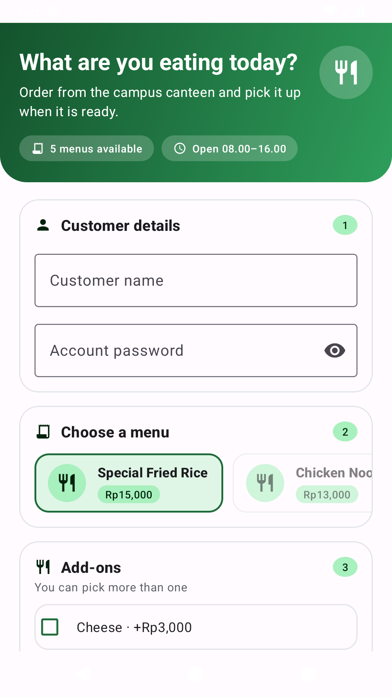
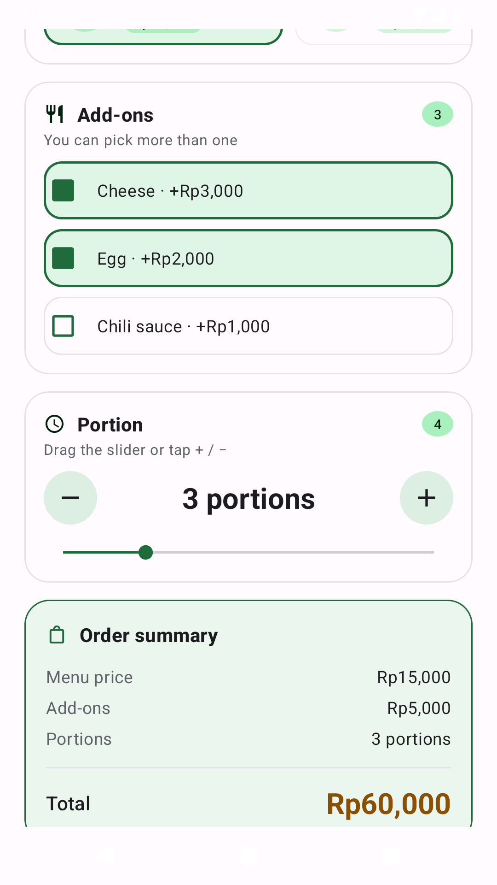
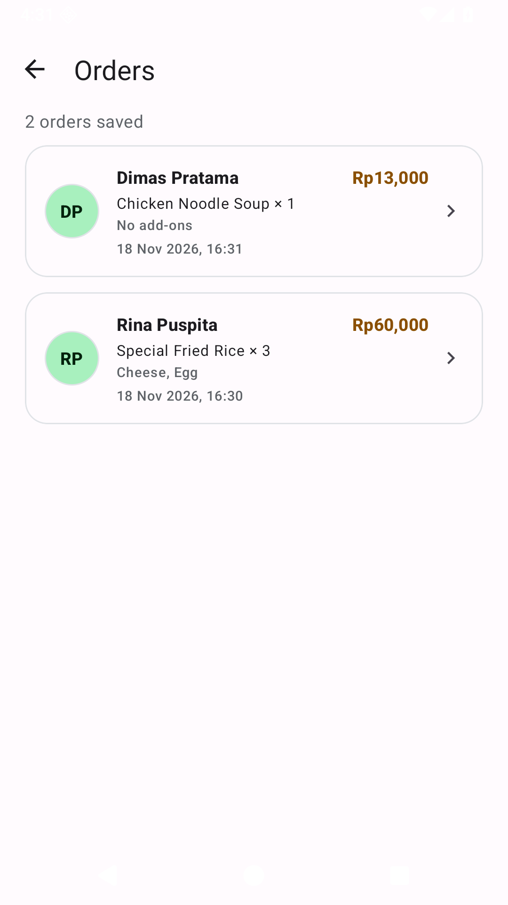
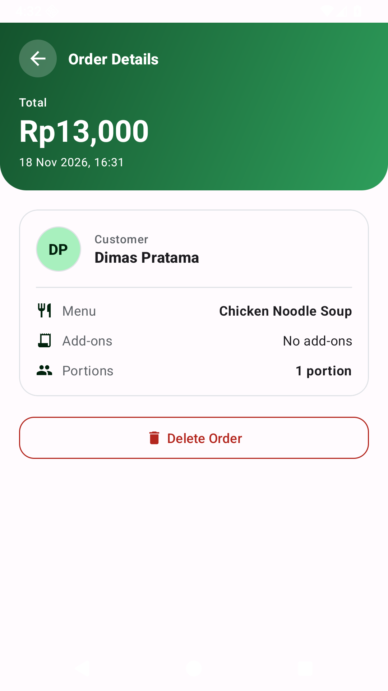
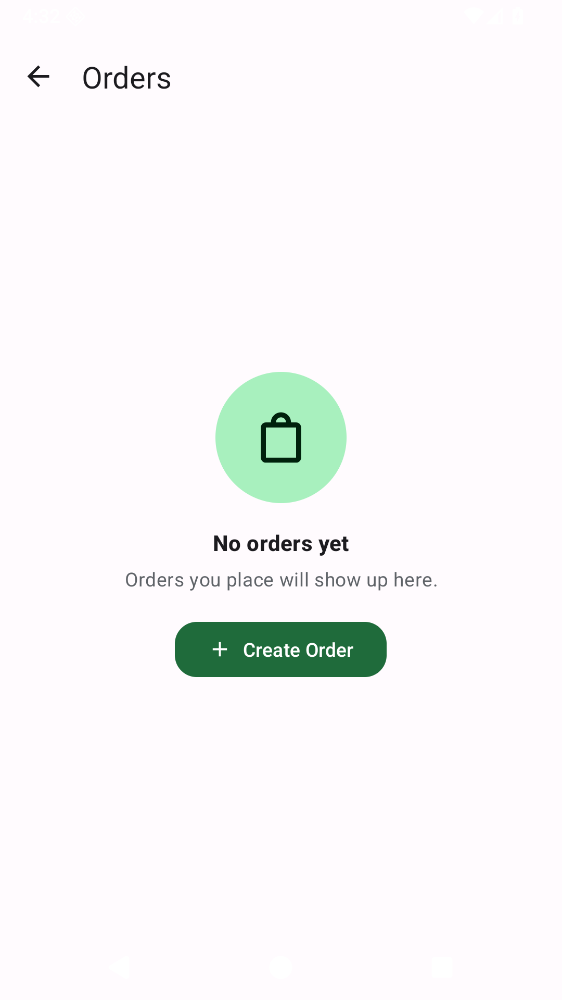

# CampusBite — Campus Canteen Ordering App

An Android app for ordering food from the campus canteen. Built for the
**Mobile Application Development** course project (Semester 20261).

Flow: fill in the order form → the order is stored in SQLite → order list → order details.

## Features

- Gradient hero header with opening hours and available menu count.
- Numbered section cards: customer details, choose a menu, add-ons, portion, summary.
- Horizontal menu picker: the selected card lights up and shows its price in a pill.
- Add-ons as rows that change colour and border when ticked.
- Portion count through a + / − stepper and a synced SeekBar slider.
- Running total (count-up animation) plus a breakdown of menu price, add-ons and portions.
- Name and password validation with inline errors and auto-scroll to the failing field.
- Orders persisted in a local SQLite database.
- Order list with initial avatars, saved order count, and tappable cards.
- Detail screen with a hero total, order breakdown, and delete action.
- Illustrated empty state with a "Create Order" button.
- Screen transitions (slide + fade) and a Material 3 theme with dark mode support.

## Requirement Coverage

| Requirement | Implementation |
|---|---|
| Intent and Activity | 3 activities: `MainActivity` → `OrderListActivity` → `OrderDetailActivity`. Navigation uses explicit `Intent`s; the order is passed through the `order_id` Intent extra. |
| Text Input | `TextInputLayout` + `TextInputEditText` for the customer name (`inputName`). |
| Password input | `TextInputEditText` with `inputType="textPassword"` and a show/hide toggle (`inputPassword`). |
| Selection (Spinner) | `Spinner` listing the menu with prices (`spinnerMenu`). |
| Checkbox / Radio Button | 3 `CheckBox` add-ons: cheese, egg, chili sauce. |
| Button | `MaterialButton` for "Place Order", "View Orders" and "Delete Order". |
| SeekBar | `SeekBar` for 1–10 portions (`seekPortion`); the total updates as it moves. |
| Database | SQLite through `OrderDbHelper` (`SQLiteOpenHelper`): the `orders` table with insert, query and delete. |
| Workflow & design | Form → save → list → detail → delete; Material 3 UI with a hero header, section cards, animated total, screen transitions and dark mode. |

## Code Structure

```
app/src/main/java/com/oswaldvalois/canteenorder/
├── MainActivity.java        # Order form, validation, writes to SQLite
├── OrderListActivity.java   # Order list (RecyclerView)
├── OrderDetailActivity.java # Order details and delete action
├── OrderAdapter.java        # RecyclerView adapter with initial avatars
├── OrderDbHelper.java       # SQLiteOpenHelper (CRUD for the orders table)
├── Order.java               # Order model
├── MenuItem.java            # Menu model (name + price)
├── Money.java               # Rupiah formatting
└── BaseActivity.java        # System bar insets and screen transitions
```

## Build

Requirements: Android Studio (JDK 17+) and the Android SDK.

```bash
./gradlew assembleDebug
```

The APK lands in `app/build/outputs/apk/debug/app-debug.apk`.

Or open the project folder in Android Studio and press Run.

## Screenshots

| Order Form | Form Filled In | Orders |
|---|---|---|
|  |  |  |

| Order Details | Empty State |
|---|---|
|  |  |

## Specifications

- Language: Java
- minSdk 24, targetSdk 37, compileSdk 37
- Android Gradle Plugin 9.3.2, Gradle 9.5
- Libraries: AndroidX AppCompat, Material Components, RecyclerView
