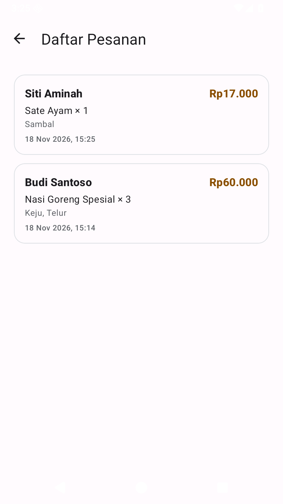
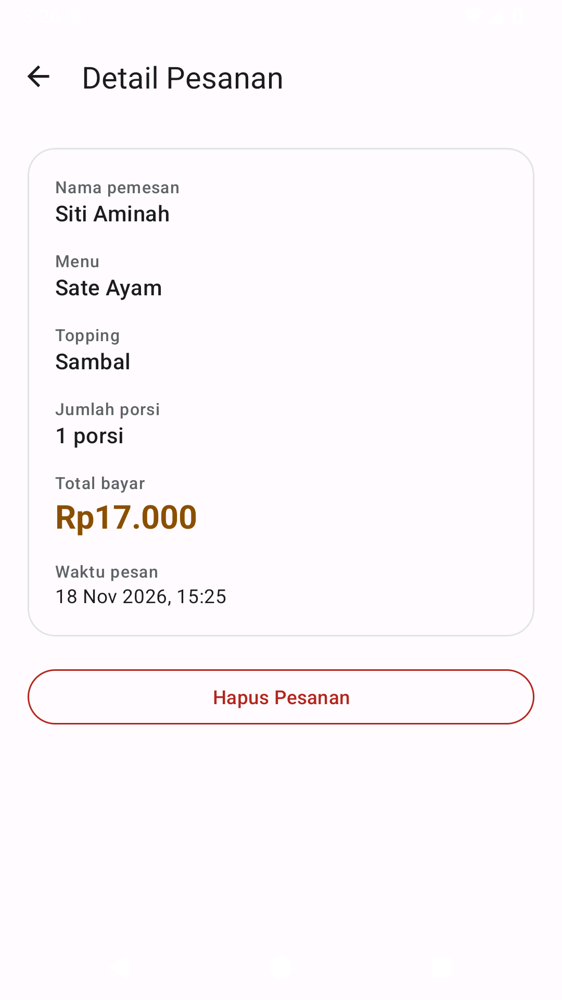

# KantinKu — Aplikasi Pemesanan Makanan Kantin

Aplikasi Android untuk memesan makanan kantin. Dibuat untuk Tugas Proyek
mata kuliah **Mobile Application Development** (Semester 20261).

Alur: isi form pesanan → data disimpan ke SQLite → daftar pesanan → detail pesanan.

## Fitur

- Form pesanan dengan validasi nama dan password.
- Perhitungan total otomatis dari harga menu, topping, dan jumlah porsi.
- Penyimpanan pesanan ke database SQLite lokal.
- Daftar pesanan (terbaru di atas) dan halaman detail.
- Hapus pesanan dari halaman detail.
- Tema Material 3 dengan dukungan mode gelap.

## Pemenuhan Requirement

| Requirement | Implementasi |
|---|---|
| Intent dan Activity | 3 Activity: `MainActivity` → `OrderListActivity` → `OrderDetailActivity`. Perpindahan memakai `Intent` eksplisit, data pesanan dikirim lewat `Intent` extra (`order_id`). |
| Text Input | `TextInputLayout` + `TextInputEditText` untuk nama pemesan (`inputName`). |
| Password input | `TextInputEditText` dengan `inputType="textPassword"` dan tombol tampil/sembunyikan password (`inputPassword`). |
| Selection (Spinner) | `Spinner` daftar menu beserta harga (`spinnerMenu`). |
| Checkbox / Radio Button | 3 `CheckBox` topping: keju, telur, sambal. |
| Button | `MaterialButton` "Pesan Sekarang", "Lihat Pesanan", dan "Hapus Pesanan". |
| SeekBar | `SeekBar` jumlah porsi 1–10 (`seekPortion`), total ikut berubah. |
| Database | SQLite via `OrderDbHelper` (`SQLiteOpenHelper`): tabel `orders`, operasi insert, query, dan delete. |
| Workflow & desain | Alur form → simpan → daftar → detail → hapus, UI Material 3, kartu, warna konsisten, mode gelap. |

## Struktur Kode

```
app/src/main/java/com/oswaldvalois/canteenorder/
├── MainActivity.java        # Form pesanan + validasi + simpan ke SQLite
├── OrderListActivity.java   # Daftar pesanan (RecyclerView)
├── OrderDetailActivity.java # Detail pesanan + hapus
├── OrderAdapter.java        # Adapter RecyclerView
├── OrderDbHelper.java       # SQLiteOpenHelper (CRUD tabel orders)
├── Order.java               # Model pesanan
├── MenuItem.java            # Model menu (nama + harga)
├── Money.java               # Format rupiah
└── BaseActivity.java        # Penanganan system bar insets
```

## Cara Build

Prasyarat: Android Studio (JDK 17+) dan Android SDK.

```bash
./gradlew assembleDebug
```

APK hasil build: `app/build/outputs/apk/debug/app-debug.apk`.

Atau buka folder proyek di Android Studio, lalu Run.

## Screenshot

| Form Pesanan | Daftar Pesanan | Detail Pesanan |
|---|---|---|
|  |  |  |

## Spesifikasi

- Bahasa: Java
- minSdk 24, targetSdk 37, compileSdk 37
- Android Gradle Plugin 9.3.2, Gradle 9.5
- Library: AndroidX AppCompat, Material Components, RecyclerView
